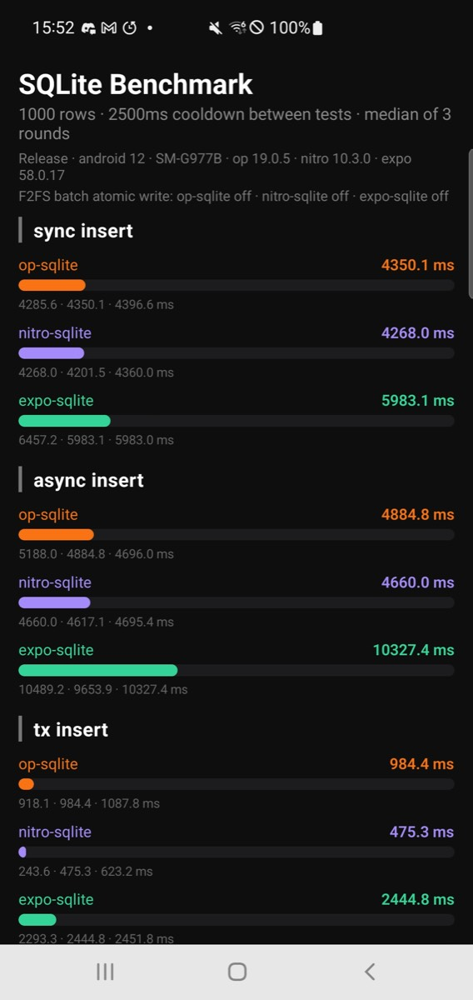
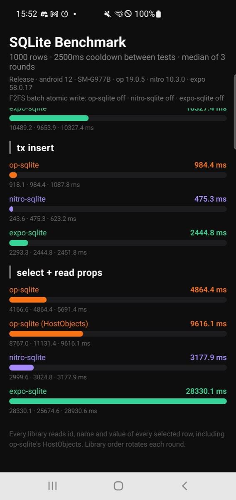

# Results, 13 November 2026

These runs compare op-sqlite 19.0.5, Nitro SQLite 10.3.0 and expo-sqlite 58.0.17 on Expo SDK 58 (React Native 0.88.1, Hermes) in Release builds. They cover the four tests from the original benchmark screen on a Galaxy S10 5G, the iOS simulator and the Android emulator, the same tests on F2FS with batch atomic writes off and on, and the full suite with prepared statements, batches, raw arrays and the newer cases on the iOS simulator, the Android emulator and the Galaxy S10.

## Summary

Nitro SQLite reads faster than op-sqlite on every device. On "select + read props", which runs 1,000 queries of 1,000 rows and reads every property, Nitro took 3,212 ms on the Galaxy S10 against op-sqlite's 4,864 ms (1.51×), and was 1.22× to 1.36× faster in the simulator and emulator runs.

Single-row commits, the sync and async insert tests, are level. With batch atomic writes off for both, the two libraries stay within 6% of each other on every device, because each of those tests is mostly 1,000 disk syncs.

The transaction insert runs 1,000 awaited inserts inside one transaction. Nitro was 1.90× faster on the Galaxy S10 (484 ms against 918 ms). On the iOS simulator op-sqlite was faster (24 ms against 27 ms), and on the Android emulator the two were within 13%.

Turning on F2FS batch atomic writes for both libraries shortened commits on the emulated F2FS volume by about 10–20% for both, and the ratios between them stayed within the run-to-run spread. Nitro's lead on reads comes from its result conversion, not from a compile flag.

In the full suite on the Galaxy S10, Nitro SQLite was faster in 17 of the 24 cases that both libraries support. Its largest leads were async inserts inside an explicit transaction (3.01×), prepared sync full reads (2.60×) and the 100,000-row async read (2.16×). While that large result loaded, the longest frame gap was 55 ms with Nitro against 209 ms with op-sqlite.

On the same Galaxy S10 in September, with Nitro SQLite main before 10.2.0, the read test took 18,517 ms with Nitro and 4,843 ms with op-sqlite.

## Setup

Both op-sqlite and Nitro SQLite compile SQLite 3.53.4 with their performance flags on and use `fdatasync()` for commits on Android. Batch atomic writes are off for both except in the F2FS-on runs. expo-sqlite uses its own SQLite 3.53.3 with its defaults. Nitro SQLite prefixes its SQLite symbols, so on iOS each library runs its own SQLite copy.

The four tests use the same workloads as the original screen: 1,000 rows, 1,000 `SELECT *` queries and a 2.5 second cooldown before each test. Compared with the original screen, every library now gets the same cooldowns, op-sqlite's HostObjects case reads every property like the other libraries, and each launch runs three rounds with the library order rotating. The tables pool every round of every launch.

The iPhone simulator and Android emulator ran on an Apple Silicon Mac with other simulators active, so their absolute times only describe that Mac, and their small differences are within noise. The emulator's `/data` uses ext4. For the F2FS runs, the app's `databases` and `files` folders were mounted on F2FS loop volumes inside the emulator, with SELinux set to permissive. An emulated F2FS volume is not a phone's flash storage, so the size of the batch atomic write effect there does not carry over to phones.

## Original four tests

### Galaxy S10 5G (SM-G977B), Android 12, physical phone

3 launches × 3 rounds. Median ms, minimum to maximum in brackets.

| Test | op-sqlite | op-sqlite HostObjects | Nitro SQLite | expo-sqlite | op-sqlite ÷ Nitro |
|---|---:|---:|---:|---:|---:|
| sync insert | 4,373 (4,077–4,480) | – | 4,360 (4,202–4,536) | 6,334 (5,983–6,719) | 1.00 |
| async insert | 4,798 (4,696–5,188) | – | 4,695 (4,587–4,833) | 10,265 (9,575–10,556) | 1.02 |
| tx insert | 918 (333–1,088) | – | 484 (244–730) | 2,445 (2,165–2,646) | 1.90 |
| select + read props | 4,864 (3,435–5,691) | 10,046 (8,767–11,131) | 3,212 (2,569–3,825) | 28,931 (24,821–30,993) | 1.51 |

### iPhone 18 Pro simulator, iOS 27

3 launches × 3 rounds. Median ms, minimum to maximum in brackets.

| Test | op-sqlite | op-sqlite HostObjects | Nitro SQLite | expo-sqlite | op-sqlite ÷ Nitro |
|---|---:|---:|---:|---:|---:|
| sync insert | 344 (306–588) | – | 331 (309–570) | 448 (327–635) | 1.04 |
| async insert | 364 (332–736) | – | 386 (347–770) | 442 (400–735) | 0.94 |
| tx insert | 24 (20–27) | – | 27 (21–33) | 85 (71–89) | 0.86 |
| select + read props | 360 (350–486) | 607 (592–701) | 265 (254–380) | 920 (899–1,071) | 1.36 |

### Android emulator (Pixel 9 Pro image), Android 15, ext4

3 launches × 3 rounds. Median ms, minimum to maximum in brackets.

| Test | op-sqlite | op-sqlite HostObjects | Nitro SQLite | expo-sqlite | op-sqlite ÷ Nitro |
|---|---:|---:|---:|---:|---:|
| sync insert | 1,119 (1,057–1,261) | – | 1,120 (1,087–1,312) | 1,429 (1,308–1,988) | 1.00 |
| async insert | 1,316 (1,199–1,454) | – | 1,279 (1,155–1,546) | 1,902 (1,604–2,246) | 1.03 |
| tx insert | 127 (110–149) | – | 128 (96–156) | 471 (443–935) | 0.99 |
| select + read props | 419 (381–469) | 763 (719–842) | 312 (295–338) | 2,090 (1,996–2,291) | 1.34 |

### Android emulator on an F2FS volume, batch atomic writes off

4 launches × 3 rounds. Median ms, minimum to maximum in brackets.

| Test | op-sqlite | op-sqlite HostObjects | Nitro SQLite | expo-sqlite | op-sqlite ÷ Nitro |
|---|---:|---:|---:|---:|---:|
| sync insert | 2,819 (2,317–3,124) | – | 2,681 (2,464–3,220) | 3,094 (2,529–3,654) | 1.05 |
| async insert | 2,484 (2,399–3,234) | – | 2,633 (2,397–3,224) | 3,155 (2,880–3,684) | 0.94 |
| tx insert | 129 (113–165) | – | 116 (103–149) | 474 (444–797) | 1.11 |
| select + read props | 422 (404–484) | 782 (730–1,161) | 346 (292–371) | 2,174 (2,012–2,455) | 1.22 |

### Android emulator on an F2FS volume, batch atomic writes on

3 launches × 3 rounds. Median ms, minimum to maximum in brackets.

| Test | op-sqlite | op-sqlite HostObjects | Nitro SQLite | expo-sqlite | op-sqlite ÷ Nitro |
|---|---:|---:|---:|---:|---:|
| sync insert | 2,420 (1,337–2,672) | – | 2,112 (1,089–2,853) | 2,879 (2,555–3,743) | 1.15 |
| async insert | 2,518 (1,361–2,776) | – | 2,495 (1,449–2,627) | 3,000 (2,603–3,594) | 1.01 |
| tx insert | 135 (115–313) | – | 119 (106–213) | 460 (391–501) | 1.13 |
| select + read props | 424 (396–465) | 813 (763–874) | 328 (306–390) | 2,140 (2,011–2,372) | 1.29 |

### Screenshots

Each screenshot pair shows one launch, with the top of the screen first and the remaining tests below it.

| Device | Screenshots |
|---|---|
| Galaxy S10 | run 1 [top](screenshots/galaxy-s10-original/run1-1-top.jpg) and [bottom](screenshots/galaxy-s10-original/run1-2-bottom.jpg), run 2 [top](screenshots/galaxy-s10-original/run2-1-top.jpg) and [bottom](screenshots/galaxy-s10-original/run2-2-bottom.jpg), run 3 [top](screenshots/galaxy-s10-original/run3-1-top.jpg) and [bottom](screenshots/galaxy-s10-original/run3-2-bottom.jpg) |
| iPhone simulator | [top](screenshots/iphone-simulator-original/1-top.jpg) and [bottom](screenshots/iphone-simulator-original/2-bottom.jpg) |
| Android emulator, ext4 | [top](screenshots/android-emulator-ext4-original/1-top.jpg) and [bottom](screenshots/android-emulator-ext4-original/2-bottom.jpg) |
| Android emulator, F2FS, batch atomic writes off | [top](screenshots/android-emulator-f2fs-off-original/1-top.jpg) and [bottom](screenshots/android-emulator-f2fs-off-original/2-bottom.jpg) |
| Android emulator, F2FS, batch atomic writes on | run 1 [top](screenshots/android-emulator-f2fs-on-original/run1-1-top.jpg) and [bottom](screenshots/android-emulator-f2fs-on-original/run1-2-bottom.jpg), run 2 [top](screenshots/android-emulator-f2fs-on-original/run2-1-top.jpg) and [bottom](screenshots/android-emulator-f2fs-on-original/run2-2-bottom.jpg), run 3 [top](screenshots/android-emulator-f2fs-on-original/run3-1-top.jpg) and [bottom](screenshots/android-emulator-f2fs-on-original/run3-2-bottom.jpg) |

## Suite

The suite uses 250 rows, one warmup round and three measured rounds, and rotates the library order for every case. Each cell shows op-sqlite's and Nitro SQLite's median and the ratio, where a value above 1 means Nitro was faster. The Expo numbers are in the data files. The iPhone simulator and the Galaxy S10 ran the suite once. The Android emulator ran it twice, and the table shows the second run, which has a screenshot of every page. The Galaxy S10 run and the second emulator run used the same Release build on 14 November.

| Case | iPhone simulator: op / Nitro ms | Android emulator: op / Nitro ms | Galaxy S10: op / Nitro ms |
|---|---:|---:|---:|
| sync-insert | 86.7 / 85.3 (1.02×) | 282.4 / 283.1 (1.00×) | 1,118.9 / 1,201.8 (0.93×) |
| async-insert | 93.8 / 102.0 (0.92×) | 308.3 / 307.3 (1.00×) | 1,268.7 / 1,306.1 (0.97×) |
| transaction-insert | 10.6 / 10.3 (1.03×) | 58.6 / 55.8 (1.05×) | 232.9 / 124.1 (1.88×) |
| full-read | 38.2 / 38.5 (0.99×) | 87.0 / 85.5 (1.02×) | 666.9 / 524.0 (1.27×) |
| host-creation | 43.2 / – | 96.6 / – | 863.8 / – |
| host-full-read | 61.6 / – | 113.5 / – | 976.5 / – |
| ordinary-sync-full-read | 31.8 / 31.3 (1.02×) | 52.7 / 40.9 (1.29×) | 170.9 / 160.8 (1.06×) |
| prepared-sync-full-read | 46.0 / 30.1 (1.53×) | 81.6 / 53.6 (1.52×) | 293.0 / 112.7 (2.60×) |
| ordinary-async-full-read | 42.0 / 37.6 (1.12×) | 84.8 / 83.9 (1.01×) | 630.2 / 539.3 (1.17×) |
| prepared-async-full-read | 60.9 / 40.5 (1.50×) | 114.6 / 86.7 (1.32×) | 1,033.3 / 792.3 (1.30×) |
| ordinary-sync-point-read | 9.7 / 9.4 (1.03×) | 4.8 / 4.4 (1.09×) | 37.4 / 31.8 (1.17×) |
| prepared-sync-point-read | 9.0 / 9.2 (0.98×) | 7.9 / 3.4 (2.33×) | 29.4 / 30.5 (0.96×) |
| ordinary-async-point-read | 12.4 / 14.9 (0.83×) | 43.6 / 55.8 (0.78×) | 292.7 / 227.6 (1.29×) |
| prepared-async-point-read | 12.7 / 16.6 (0.76×) | 56.3 / 58.3 (0.97×) | 303.7 / 325.5 (0.93×) |
| ordinary-sync-manual-transaction-insert | 2.1 / 3.5 (0.61×) | 5.1 / 3.1 (1.66×) | 14.6 / 18.9 (0.77×) |
| prepared-sync-manual-transaction-insert | 2.7 / 2.3 (1.17×) | 4.7 / 4.9 (0.95×) | 16.6 / 16.4 (1.01×) |
| ordinary-async-manual-transaction-insert | 9.7 / 10.4 (0.93×) | 59.0 / 46.9 (1.26×) | 276.4 / 91.8 (3.01×) |
| prepared-async-manual-transaction-insert | 10.6 / 10.4 (1.01×) | 61.3 / 58.3 (1.05×) | 274.2 / 239.0 (1.15×) |
| native-async-batch-insert | 3.3 / 2.6 (1.23×) | 6.5 / 7.9 (0.82×) | 18.3 / 19.9 (0.92×) |
| raw-sync-full-read | 39.4 / 33.6 (1.17×) | 58.8 / 55.7 (1.06×) | 195.2 / 113.8 (1.71×) |
| raw-async-full-read | 47.6 / 41.4 (1.15×) | 75.9 / 85.3 (0.89×) | 743.3 / 500.7 (1.48×) |
| wide-async-full-read | 212.6 / 199.6 (1.07×) | 222.3 / 211.0 (1.05×) | 2,015.9 / 1,671.9 (1.21×) |
| blob-async-read | 32.9 / 26.3 (1.25×) | 62.4 / 50.1 (1.25×) | 186.3 / 119.6 (1.56×) |
| large-async-read | 45.2 / 36.2 (1.25×) | 69.0 / 59.6 (1.16×) | 245.5 / 113.7 (2.16×) |
| large-async-read-frame-gap | 39.8 / 35.2 (1.13×) | 44.9 / 32.5 (1.38×) | 209.2 / 55.5 (3.77×) |
| concurrent-async-point-read | 9.7 / 8.3 (1.17×) | 5.0 / 9.9 (0.50×) | 25.4 / 33.8 (0.75×) |
| native-sync-batch-insert | – / 2.0 | – / 4.8 | – / 15.1 |

On every device, Nitro SQLite is ahead on prepared full reads, BLOBs, the 20-column read and the large result, and the longest frame gap while the 100,000-row result loads is shorter. Plain full reads are level on the iPhone simulator and the Android emulator, and 1.27× faster on the Galaxy S10.

The emulator's ratios moved a lot between its two runs. For example, the plain full read went from 1.77× to 1.02×, so a single emulator result is only a rough guide. Both runs are in the data file.

Some results go the other way and are worth profiling:

- Ordinary sync inserts inside an explicit transaction were 0.61× on the iPhone simulator and 0.77× on the Galaxy S10, but 1.66× in the second emulator run.
- Native async batch inserts were 0.82× on the Android emulator and 0.92× on the Galaxy S10.
- Async point lookups were 0.76× to 0.83× on the iPhone simulator and 0.78× (ordinary) on the Android emulator. On the Galaxy S10, prepared async point lookups were 0.93× and ordinary ones 1.29×.
- All point lookups in flight at once came out at 0.50× on the Android emulator and 0.75× on the Galaxy S10, while the iPhone simulator shows the opposite. Their samples spread widely: on the phone, op-sqlite ranged from 16 to 37 ms and Nitro from 31 to 40 ms.
- Async raw array reads were 0.89× in the second emulator run, against 1.15× on the iPhone simulator and 1.48× on the Galaxy S10.
- Single-row inserts on the Galaxy S10 were 0.93× (sync) and 0.97× (async) in the suite, and level in the original four tests on the same phone.

The first emulator run showed prepared-statement inserts inside a transaction at 0.34× (sync) and 0.55× (async). The second emulator run (0.95× and 1.05×) and the Galaxy S10 (1.01× and 1.15×) did not repeat it.

The suite's full screens are in [screenshots/iphone-simulator-suite](screenshots/iphone-simulator-suite), [screenshots/android-emulator-suite](screenshots/android-emulator-suite) and [screenshots/galaxy-s10-suite](screenshots/galaxy-s10-suite). Every run's raw samples and manifest are in [data](data).

## Reproducing the runs

Build a Release app for each platform. The flows in `.argent/e2e` open the original four tests or start the suite, wait for the run to finish and take a screenshot. Each finished run is saved as JSON in the app's documents folder and printed to the log with the `SQLITE_BENCH` prefix.

To measure with batch atomic writes, set `nitroSQLite.enableBatchAtomicWrite` to `true` and add `-DSQLITE_ENABLE_BATCH_ATOMIC_WRITE=1` to `op-sqlite.sqliteFlags` in `package.json`. Expo's project fingerprint does not include these fields, so a cached native build can be reused without them. Rebuild the native app without a build cache, then check the "F2FS batch atomic write" line at the top of the screen.
