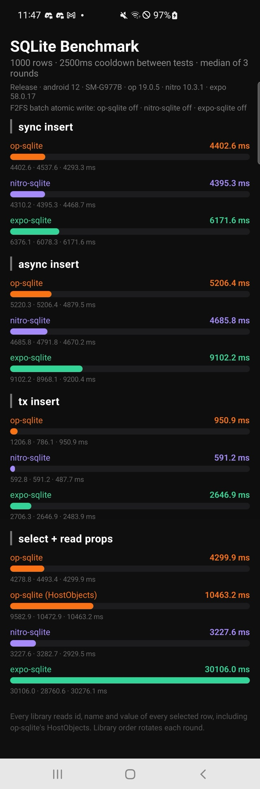
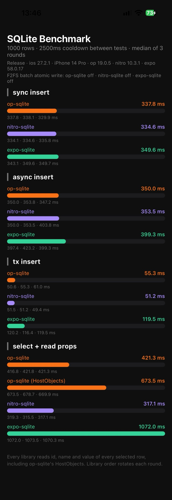

# Results, 17 November 2026

These runs repeat the [13 November runs](../2026-11-13) with Nitro SQLite 10.3.1. Everything else is unchanged: op-sqlite 19.0.5 and expo-sqlite 58.0.17 on Expo SDK 58 (React Native 0.88.1, Hermes), Release builds, the same SQLite flags, and the same Galaxy S10 5G, iPhone 14 Pro, iOS simulator and Android emulator. The emulator ran on ext4 only.

Nitro SQLite 10.3.1 changes only how async calls reach the native side:

- It removes promise layers from async queries, batches, file loading and transactions ([#496](https://github.com/margelo/react-native-nitro-sqlite/pull/496), [#499](https://github.com/margelo/react-native-nitro-sqlite/pull/499), [#500](https://github.com/margelo/react-native-nitro-sqlite/pull/500)).
- A deferred `BEGIN` runs synchronously, like `COMMIT` ([#501](https://github.com/margelo/react-native-nitro-sqlite/pull/501)).
- A statement starts directly when nothing else is queued on its connection ([#502](https://github.com/margelo/react-native-nitro-sqlite/pull/502)).
- Prepared statements run their async executions on the connection's worker thread instead of a shared thread pool ([#503](https://github.com/margelo/react-native-nitro-sqlite/pull/503)).
- Row batches of large results go to one registered handler instead of a new callback per query ([#504](https://github.com/margelo/react-native-nitro-sqlite/pull/504)).

Synchronous calls work the same as in 10.3.0.

## Summary

The async losses from 13 November are mostly gone. 250 point reads in flight was Nitro SQLite's clearest loss on both phones and the Android emulator. In the suite it is now level with op-sqlite on both phones: 29.7 ms against 29.0 ms on the Galaxy S10 (0.75× before) and 15.6 ms against 15.6 ms on the iPhone 14 Pro (0.65× before). In WAL mode the iPhone went from 0.60× to 0.99×. The Galaxy S10 went from 0.47× to 0.62× in one WAL run and 1.04× in a second.

Prepared statements gained the most on the Galaxy S10, where their async executions now run on the connection's own worker thread. Prepared async point reads went from 0.93× to 1.69× (182 ms against op-sqlite's 308 ms), prepared async full reads from 1.30× to 2.09×, and prepared async inserts inside a transaction from 1.15× to 2.33×. Both WAL runs show the same gains.

On the iPhone 14 Pro in WAL mode, async inserts inside an explicit transaction caught up. Ordinary ones took 23.7 ms against op-sqlite's 23.9 ms and prepared ones 23.2 ms against 21.5 ms, where 10.3.0 took 28.5 ms and 27.3 ms. Async point reads moved from 0.72× to 1.02× (ordinary) and from 0.87× to 1.02× (prepared).

Two things did not change. On the iPhone 14 Pro, the longest frame gap while the 100,000-row result loads is still longer with Nitro SQLite: 73 ms against 53 ms, and 78 ms against 48 ms in WAL mode ([#497](https://github.com/margelo/react-native-nitro-sqlite/issues/497)). On the Galaxy S10, ordinary sync inserts inside an explicit transaction are still slower, 0.76× against 0.77× on 13 November.

The original four tests moved little on the phones. Their sync and async insert tests wait for a disk sync on every insert, which takes milliseconds, so a few microseconds less per call does not show. The transaction insert went from 0.99× to 1.04× on the iPhone 14 Pro and from 1.90× to 1.93× on the Galaxy S10. The read test came out at 1.33× on the iPhone 14 Pro (1.31× before) and 1.39× on the Galaxy S10 (1.51× before, within that phone's run-to-run spread).

The per-call probe shows the same picture on the Galaxy S10, where 250 reads in flight now cost 94 to 99 µs per read with Nitro SQLite against 91 to 92 µs with op-sqlite (138 to 153 µs on 10.3.0). On the iPhone 14 Pro, single async reads got faster (36 µs, against 42 to 44 µs with op-sqlite), but reads in flight still cost 27 to 28 µs against 23 to 24 µs, the same as on 10.3.0. So the probe still shows a gap on the iPhone that the suite's in-flight case no longer shows.

Sync calls did not change, yet some sync cases moved between the two dates. The iPhone's sync point reads switch between about 3 ms and 10 ms per 250 reads in both libraries, so a single run can put one library at either end. In WAL mode that made ordinary sync point reads come out at 0.34×. Read single ratios in the tables with that spread in mind.

## Original four tests

The workload is the same as on 13 November: 1,000 rows, 1,000 `SELECT *` queries and a 2.5 second cooldown before each test. Each launch runs three rounds with the library order rotating, and the tables pool every round of every launch. The last column repeats the 13 November ratio.

### Galaxy S10 5G (SM-G977B), Android 12, physical phone

3 launches × 3 rounds. Median ms, minimum to maximum in brackets.

| Test | op-sqlite | op-sqlite HostObjects | Nitro SQLite | expo-sqlite | op-sqlite ÷ Nitro | 10.3.0 |
|---|---:|---:|---:|---:|---:|---:|
| sync insert | 4,345 (4,259–4,604) | – | 4,420 (3,958–5,713) | 6,172 (5,876–7,480) | 0.98 | 1.00 |
| async insert | 4,862 (4,748–5,220) | – | 4,693 (4,369–5,974) | 9,102 (8,849–9,906) | 1.04 | 1.02 |
| tx insert | 971 (786–1,268) | – | 504 (164–626) | 2,516 (2,135–2,822) | 1.93 | 1.90 |
| select + read props | 4,493 (4,144–5,413) | 10,463 (8,351–10,956) | 3,228 (1,548–3,798) | 30,276 (17,436–31,362) | 1.39 | 1.51 |

### iPhone 14 Pro, iOS 27.2.1, physical phone

3 launches × 3 rounds. Median ms, minimum to maximum in brackets.

| Test | op-sqlite | op-sqlite HostObjects | Nitro SQLite | expo-sqlite | op-sqlite ÷ Nitro | 10.3.0 |
|---|---:|---:|---:|---:|---:|---:|
| sync insert | 334 (329–343) | – | 334 (331–340) | 350 (340–355) | 1.00 | 0.99 |
| async insert | 350 (343–384) | – | 351 (344–404) | 405 (397–423) | 1.00 | 0.98 |
| tx insert | 54 (47–61) | – | 51 (48–52) | 119 (116–122) | 1.04 | 0.99 |
| select + read props | 422 (417–424) | 676 (670–680) | 317 (314–319) | 1,070 (1,068–1,074) | 1.33 | 1.31 |

### iPhone 18 Pro simulator, iOS 27

3 launches × 3 rounds. Median ms, minimum to maximum in brackets.

| Test | op-sqlite | op-sqlite HostObjects | Nitro SQLite | expo-sqlite | op-sqlite ÷ Nitro | 10.3.0 |
|---|---:|---:|---:|---:|---:|---:|
| sync insert | 307 (268–321) | – | 300 (283–319) | 320 (310–324) | 1.03 | 1.04 |
| async insert | 313 (308–335) | – | 318 (305–329) | 379 (344–393) | 0.98 | 0.94 |
| tx insert | 26 (23–31) | – | 23 (19–36) | 93 (75–98) | 1.14 | 0.86 |
| select + read props | 351 (334–397) | 596 (582–604) | 256 (240–259) | 897 (855–927) | 1.37 | 1.36 |

### Android emulator (Pixel 9 Pro image), Android 15, ext4

3 launches × 3 rounds. Median ms, minimum to maximum in brackets.

| Test | op-sqlite | op-sqlite HostObjects | Nitro SQLite | expo-sqlite | op-sqlite ÷ Nitro | 10.3.0 |
|---|---:|---:|---:|---:|---:|---:|
| sync insert | 1,150 (1,064–1,217) | – | 1,175 (1,021–1,270) | 1,424 (1,372–1,608) | 0.98 | 1.00 |
| async insert | 1,283 (1,199–1,372) | – | 1,280 (1,192–1,346) | 2,007 (1,913–2,574) | 1.00 | 1.03 |
| tx insert | 145 (109–172) | – | 134 (105–144) | 492 (459–575) | 1.08 | 0.99 |
| select + read props | 432 (416–459) | 865 (815–893) | 335 (299–459) | 2,144 (2,106–2,230) | 1.29 | 1.34 |

### Screenshots

Each pair shows one launch, with the top of the screen first and the remaining tests below it.

| Device | Screenshots |
|---|---|
| Galaxy S10 | run 1 [top](screenshots/galaxy-s10-original/run1-1-top.jpg) and [bottom](screenshots/galaxy-s10-original/run1-2-bottom.jpg), run 2 [top](screenshots/galaxy-s10-original/run2-1-top.jpg) and [bottom](screenshots/galaxy-s10-original/run2-2-bottom.jpg), run 3 [top](screenshots/galaxy-s10-original/run3-1-top.jpg) and [bottom](screenshots/galaxy-s10-original/run3-2-bottom.jpg) |
| iPhone 14 Pro | run 1 [top](screenshots/iphone-14-pro-original/run1-1-top.jpg) and [bottom](screenshots/iphone-14-pro-original/run1-2-bottom.jpg), run 2 [top](screenshots/iphone-14-pro-original/run2-1-top.jpg) and [bottom](screenshots/iphone-14-pro-original/run2-2-bottom.jpg), run 3 [top](screenshots/iphone-14-pro-original/run3-1-top.jpg) and [bottom](screenshots/iphone-14-pro-original/run3-2-bottom.jpg) |
| iPhone simulator | run 1 [top](screenshots/iphone-simulator-original/run1-1-top.jpg) and [bottom](screenshots/iphone-simulator-original/run1-2-bottom.jpg), run 2 [top](screenshots/iphone-simulator-original/run2-1-top.jpg) and [bottom](screenshots/iphone-simulator-original/run2-2-bottom.jpg), run 3 [top](screenshots/iphone-simulator-original/run3-1-top.jpg) and [bottom](screenshots/iphone-simulator-original/run3-2-bottom.jpg) |
| Android emulator, ext4 | run 1 [top](screenshots/android-emulator-original/run1-1-top.jpg) and [bottom](screenshots/android-emulator-original/run1-2-bottom.jpg), run 2 [top](screenshots/android-emulator-original/run2-1-top.jpg) and [bottom](screenshots/android-emulator-original/run2-2-bottom.jpg), run 3 [top](screenshots/android-emulator-original/run3-1-top.jpg) and [bottom](screenshots/android-emulator-original/run3-2-bottom.jpg) |

## Suite

The suite uses 250 rows, one warmup round and three measured rounds, and rotates the library order for every case. Each cell is op-sqlite's median divided by Nitro SQLite's, so a value above 1 means Nitro SQLite was faster. A `*` marks a case where the two libraries' samples do not overlap. The milliseconds are on the screenshots and in the data files. The 10.3.0 columns repeat the 13 November results.

The Galaxy S10 ran the WAL suite twice, and both runs are in the table, because its samples spread widely.

### Galaxy S10

| Case | Defaults 10.3.0 | Defaults 10.3.1 | WAL 10.3.0 | WAL 10.3.1, run 1 | WAL 10.3.1, run 2 |
|---|---:|---:|---:|---:|---:|
| sync-insert | 0.93×* | 1.05× | 1.07× | 0.94× | 0.99× |
| async-insert | 0.97×* | 0.99× | 1.14× | 1.18×* | 1.19× |
| transaction-insert | 1.88×* | 2.82×* | 2.69×* | 2.50×* | 2.21×* |
| full-read | 1.27× | 1.24×* | 1.15× | 1.22×* | 1.15×* |
| ordinary-sync-full-read | 1.06× | 1.27× | 1.61× | 1.18× | 1.27× |
| prepared-sync-full-read | 2.60×* | 1.84×* | 1.85×* | 2.00×* | 1.95×* |
| ordinary-async-full-read | 1.17× | 1.29×* | 1.27× | 1.14×* | 1.23×* |
| prepared-async-full-read | 1.30×* | 2.09×* | 1.32× | 2.05×* | 1.73×* |
| ordinary-sync-point-read | 1.17× | 0.95× | 0.75× | 0.89×* | 1.05× |
| prepared-sync-point-read | 0.96× | 1.12× | 1.19× | 0.89× | 0.92× |
| ordinary-async-point-read | 1.29×* | 1.71×* | 1.33× | 1.46×* | 1.76×* |
| prepared-async-point-read | 0.93× | 1.69×* | 1.08× | 1.77×* | 1.54×* |
| ordinary-sync-manual-transaction-insert | 0.77×* | 0.76×* | 1.05× | 0.49×* | 0.81× |
| prepared-sync-manual-transaction-insert | 1.01× | 0.88× | 0.88× | 0.77× | 0.75× |
| ordinary-async-manual-transaction-insert | 3.01×* | 3.15×* | 4.33× | 1.70×* | 2.15×* |
| prepared-async-manual-transaction-insert | 1.15× | 2.33×* | 1.08× | 2.60×* | 2.02×* |
| native-async-batch-insert | 0.92× | 1.25× | 1.29× | 1.25× | 1.15× |
| raw-sync-full-read | 1.71×* | 1.79×* | 1.42× | 1.04× | 1.30×* |
| raw-async-full-read | 1.48×* | 1.28× | 1.54× | 1.30×* | 1.20×* |
| wide-async-full-read | 1.21×* | 0.89× | 1.09× | 1.21×* | 1.10× |
| blob-async-read | 1.56× | 1.30×* | 1.33× | 1.06× | 1.17×* |
| large-async-read | 2.16×* | 1.53×* | 2.02×* | 1.73×* | 2.16×* |
| large-async-read-frame-gap | 3.77×* | 2.46×* | 2.35×* | 2.26×* | 3.25×* |
| concurrent-async-point-read | 0.75× | 0.98× | 0.47×* | 0.62× | 1.04× |

With library defaults, Nitro SQLite was faster in 18 of the 24 shared cases (17 on 10.3.0), 13 of them with separate samples. In the two WAL runs it was faster in 18 and 20 cases, 14 of them with separate samples each time.

The Galaxy S10's spread is large even for code that did not change. Prepared sync full reads moved from 2.60× to 1.84×, and the 20-column async read from 1.21× to 0.89× with library defaults while staying ahead in both WAL runs. Changes that show up in both modes and every run are the prepared async gains and the in-flight reads.

### iPhone 14 Pro

| Case | Defaults 10.3.0 | Defaults 10.3.1 | WAL 10.3.0 | WAL 10.3.1 |
|---|---:|---:|---:|---:|
| sync-insert | 1.00× | 1.03× | 1.03× | 0.97× |
| async-insert | 0.99× | 0.99× | 0.95× | 0.97× |
| transaction-insert | 1.15× | 0.82× | 1.01×* | 1.02×* |
| full-read | 1.07× | 1.05× | 1.04× | 1.04×* |
| ordinary-sync-full-read | 0.97× | 1.02×* | 1.09×* | 1.07×* |
| prepared-sync-full-read | 1.28×* | 1.30× | 1.28×* | 1.30×* |
| ordinary-async-full-read | 1.07× | 1.06×* | 1.02× | 1.03× |
| prepared-async-full-read | 1.34×* | 1.36×* | 1.34×* | 1.36×* |
| ordinary-sync-point-read | 1.03× | 1.00× | 0.95× | 0.34×* |
| prepared-sync-point-read | 1.78× | 0.93× | 0.97× | 0.60× |
| ordinary-async-point-read | 1.15× | 1.01× | 0.72× | 1.02× |
| prepared-async-point-read | 0.90× | 1.03× | 0.87× | 1.02× |
| ordinary-sync-manual-transaction-insert | 0.95× | 1.25× | 0.97×* | 0.90×* |
| prepared-sync-manual-transaction-insert | 2.51× | 1.00× | 1.12× | 0.87× |
| ordinary-async-manual-transaction-insert | 0.81× | 0.98× | 0.83×* | 1.01× |
| prepared-async-manual-transaction-insert | 0.68× | 0.82× | 0.83×* | 0.93× |
| native-async-batch-insert | 0.71× | 1.36× | 1.43×* | 1.35×* |
| raw-sync-full-read | 1.13× | 1.12×* | 1.09×* | 1.13× |
| raw-async-full-read | 1.12×* | 1.12×* | 1.11×* | 1.12×* |
| wide-async-full-read | 1.07×* | 1.07×* | 1.07×* | 1.08×* |
| blob-async-read | 1.15× | 1.23×* | 1.09×* | 1.11×* |
| large-async-read | 1.21×* | 1.21×* | 1.22×* | 1.24×* |
| large-async-read-frame-gap | 0.68×* | 0.72×* | 0.65×* | 0.61×* |
| concurrent-async-point-read | 0.65× | 1.00× | 0.60×* | 0.99× |

With library defaults, Nitro SQLite was faster in 16 of the 24 shared cases (15 on 10.3.0), and in WAL mode in 15 (14 on 10.3.0). Where the two libraries' samples do not overlap in WAL mode, Nitro SQLite is behind in 3 cases instead of 5: the frame gap, ordinary sync point reads and ordinary sync inserts inside an explicit transaction. The last two use only sync calls, which did not change.

The iPhone's library-defaults run is noisier than its WAL run. Several cases have samples near 15 ms and 26 ms for both libraries, so those ratios swing by 0.3 or more between runs.

### Simulator and emulator

| Case | iPhone simulator 10.3.0 | iPhone simulator 10.3.1 | Android emulator 10.3.0 | Android emulator 10.3.1 |
|---|---:|---:|---:|---:|
| sync-insert | 1.02× | 1.03× | 1.00× | 1.04× |
| async-insert | 0.92× | 0.97× | 1.00× | 0.97× |
| transaction-insert | 1.03× | 1.05× | 1.05× | 0.87× |
| full-read | 0.99× | 1.08× | 1.02× | 0.77× |
| ordinary-sync-full-read | 1.02× | 1.16× | 1.29×* | 0.85× |
| prepared-sync-full-read | 1.53×* | 1.40×* | 1.52×* | 3.28×* |
| ordinary-async-full-read | 1.12× | 1.16× | 1.01× | 1.02× |
| prepared-async-full-read | 1.50×* | 1.46×* | 1.32×* | 1.80× |
| ordinary-sync-point-read | 1.03× | 1.06× | 1.09× | 1.55× |
| prepared-sync-point-read | 0.98× | 1.13× | 2.33× | 0.76× |
| ordinary-async-point-read | 0.83× | 1.11× | 0.78× | 0.52× |
| prepared-async-point-read | 0.76×* | 1.08× | 0.97× | 1.28× |
| ordinary-sync-manual-transaction-insert | 0.61× | 0.85× | 1.66× | 2.78× |
| prepared-sync-manual-transaction-insert | 1.17× | 1.16× | 0.95× | 2.05× |
| ordinary-async-manual-transaction-insert | 0.93× | 1.03× | 1.26× | 1.05× |
| prepared-async-manual-transaction-insert | 1.01× | 0.92× | 1.05× | 1.07× |
| native-async-batch-insert | 1.23× | 1.12× | 0.82× | 0.87× |
| raw-sync-full-read | 1.17×* | 1.16× | 1.06× | 1.35×* |
| raw-async-full-read | 1.15× | 1.44×* | 0.89× | 1.43×* |
| wide-async-full-read | 1.07×* | 1.12×* | 1.05×* | 1.10× |
| blob-async-read | 1.25× | 1.50×* | 1.25×* | 1.01× |
| large-async-read | 1.25×* | 1.24× | 1.16× | 1.95× |
| large-async-read-frame-gap | 1.13× | 0.95× | 1.38×* | 1.34×* |
| concurrent-async-point-read | 1.17× | 1.03× | 0.50×* | 2.20× |

These run on an Apple Silicon Mac that other work shares, so their absolute times only describe that Mac. The Mac's one-minute load average stayed between 3.7 and 5.5 during the simulator suite. During the emulator runs it was between 3.6 and 11.5. On the simulator, Nitro SQLite was faster in 20 of the 24 cases, and async point reads moved from 0.83× to 1.11× (ordinary) and from 0.76× to 1.08× (prepared). The emulator's ratios swing widely between runs, as they did on 13 November. Its 250 reads in flight went from 0.50× to 2.20×, but its ordinary async point reads went from 0.78× to 0.52×, so a single emulator run is only a rough guide.

### Suite screenshots

The full screens are in [screenshots/galaxy-s10-suite](screenshots/galaxy-s10-suite), [screenshots/galaxy-s10-normalized](screenshots/galaxy-s10-normalized) (`run1-` and `run2-`), [screenshots/iphone-14-pro-suite](screenshots/iphone-14-pro-suite), [screenshots/iphone-14-pro-normalized](screenshots/iphone-14-pro-normalized), [screenshots/iphone-simulator-suite](screenshots/iphone-simulator-suite) and [screenshots/android-emulator-suite](screenshots/android-emulator-suite). Consecutive pages overlap, so no row is missing. [screenshots/full-page](screenshots/full-page) joins each run's pages into one image.

## Per-call probe

The probe screen ([#7](https://github.com/margelo/sqlite-bench/pull/7)) times 1,000 indexed point reads, one at a time and 250 in flight, through Nitro SQLite's public API, through `NitroSQLite.native` without the JavaScript queue and result wrapper, and through op-sqlite. Each launch runs one warmup and five rounds. The table shows the median per read of each launch, in µs. The 10.3.0 numbers come from the 14 November probe runs on the same phones.

| Phone | Case | op-sqlite | Nitro SQLite 10.3.0 | Nitro SQLite 10.3.1 | `NitroSQLite.native` 10.3.1 |
|---|---|---:|---:|---:|---:|
| Galaxy S10 | 250 reads in flight | 91 to 92 (86 to 99 on 14 November) | 138 to 153 | 94 to 99 | 91 to 94 |
| iPhone 14 Pro | 250 reads in flight | 23 to 24 | 27 to 28 | 27 to 28 | 36 |
| iPhone 14 Pro | one read at a time | 42 to 44 (42 to 46 on 14 November) | 42 to 43 | 36 | 31 to 32 |

On the Galaxy S10, a read one at a time takes 530 to 1,030 µs with every library, and most of that is the wait for the worker and JavaScript threads to wake up, so that row is left out. With reads in flight on the iPhone, `NitroSQLite.native` is slower than the public API. The public API converts each result as soon as it arrives, while the probe reads the native results only after all 250 have arrived.

The screenshots are in [screenshots/overhead](screenshots/overhead) (all three iPhone launches and the third Galaxy S10 launch) and the raw results in [data/galaxy-s10-overhead.jsonl](data/galaxy-s10-overhead.jsonl) and [data/iphone-14-pro-overhead.jsonl](data/iphone-14-pro-overhead.jsonl).

## Reproducing the runs

Build a Release app for each platform from this branch with [#7](https://github.com/margelo/sqlite-bench/pull/7) (the probe screen) and [#8](https://github.com/margelo/sqlite-bench/pull/8) (one connection per library in WAL mode) applied. The flows in `.argent/e2e` open the original four tests or start the suite, wait for the run to finish and take a screenshot. Each finished run is saved as JSON in the app's documents folder and printed to the log with the `SQLITE_BENCH` prefix. Every run's raw samples and manifest are in [data](data).
