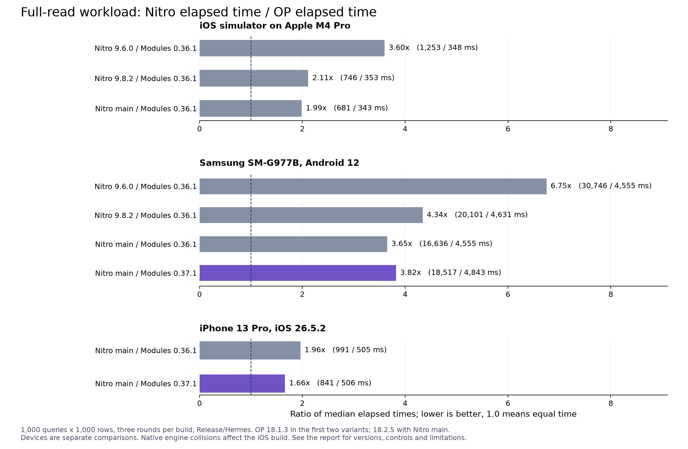

SQLite benchmark review, 25 September 2026

**The ordinary SELECT gap is real in this workload, but the suite is incomplete and the local iOS benchmark build has SQLite symbol collisions.** NitroSQLite has improved substantially since the version committed to the benchmark repository. Its remaining scalar-row conversion costs deserve optimization. Neither these charts nor the local results establish a universal ranking of the libraries.

I cloned [Oscar's benchmark repository](https://github.com/ospfranco/sqlite-bench/tree/d7c513c) and [op-sqlite](https://github.com/OP-Engineering/op-sqlite/tree/08c691379999ebf2ed98279d5fa66c047535d06f). I also checked out NitroSQLite main at `45f400cb8d617fb2c807ffc7555db80449eb7afe` in a separate worktree. The original NitroSQLite working directory and its existing untracked documentation files were left unchanged.

**Version provenance matters.** The benchmark repository's current commit is from 21 August, before the 24 September post. Its lockfile resolves NitroSQLite 9.6.0, op-sqlite 18.1.3, Nitro Modules 0.36.1, Expo SQLite 57.0.0 and React Native 0.86.0. Installing that lockfile does not reproduce a claimed latest-Nitro run. The registry's latest NitroSQLite release was 9.8.2 when checked. Prepared statements merged into main on 24 September and are absent from that published release. The latest op-sqlite release checked was 18.2.5; current op-sqlite main also contains changes beyond that release.

The June repository snapshot used op-sqlite 17.0.0, NitroSQLite 9.6.0, Nitro Modules 0.35.10, Expo SQLite 56.0.5 and React Native 0.85.3. That identifies the committed environment, not necessarily every dependency in the posted binary. The June code also differs from the August code. The earlier repeated SELECT tests discarded results, while the current ordinary SELECT tests explicitly read properties. Exact chart-to-commit provenance is missing.

**What the published results say.** I recovered the original images attached to [the September post](https://x.com/ospfranco/status/2103121330313060449) and [the June post](https://x.com/ospfranco/status/2070530027066691723). Direct X access failed, so I retrieved the original image URLs through a public mirror. The September post describes improvement but does not provide a complete version/build/device manifest. The iPhone 17 Pro identification for its newer image comes from your description.

| Workload | September newer image: op / Nitro, ms | Your colleague's iPhone: op / Nitro, ms | Your colleague's S22: op / Nitro, ms |
|---|---:|---:|---:|
| 1,000 synchronous inserts | 246.8 / 245.2 | 324.0 / 328.2 | 6,013.0 / 5,965.1 |
| 1,000 awaited inserts | 264.3 / 265.4 | 336.1 / 344.5 | 5,613.7 / 8,952.8 |
| 1,000 awaited inserts in one transaction | 45.7 / 41.6 | 43.6 / 43.8 | 274.5 / 297.2 |
| 1,000 full reads of 1,000 rows | 324.7 / 532.9 | 363.9 / 727.3 | 4,300.7 / 7,503.8 |

Those are approximately tied iOS write results, a 1.64x to 2.00x Nitro elapsed-time ratio for iOS full reads, and a 1.74x ratio for the colleague's Android reads. The Android awaited-insert ratio is 1.59x. The screenshot's small transaction differences do not establish significance without individual samples. The colleague's medians improve on a single chart, but the exact iPhone model, dependency versions, commit, build mode and individual runs remain unknown.

The other September image shows 476.8 ms for op-sqlite and 1,531.7 ms for NitroSQLite full reads. June shows 521.1 ms and 2,048.8 ms. Changing hardware, library versions, React Native/Hermes, workload code and build configuration prevents attributing those historical differences to one NitroSQLite change. Comparing libraries within one image is more defensible than dividing times across images.

**Local measurements.** All timed app builds use Release configuration and Hermes, with React Native 0.86.0 and Expo SQLite 57.0.0 held constant. The initial version comparisons also hold Nitro Modules at the benchmark's 0.36.1. A separate physical-device comparison changes only Nitro Modules to the current 0.37.1, retaining NitroSQLite main and OP 18.2.5. I retained the committed timed loops and cooldowns for the original workload, added three outer rounds, and exported results only after a complete round. These are medians of three rounds in one launch, not three independent cold launches. The supplementary tests use one discarded warmup round and three measured rounds, rotate library order, validate inserted rows, and consume every selected value into a checked checksum.

The original workloads use library defaults. The supplementary tests set WAL, synchronous FULL, a 2,000 KiB page cache and memory temporary storage for each connection. Prepared statement creation is outside the repeated-execution timer. Bulk parameter arrays are constructed before timing. The supplementary transaction tests use explicit BEGIN/COMMIT on a dedicated connection without concurrent users. They therefore measure a different transaction path from the original callback-transaction workload. The supplementary full-read test performs 250 queries of 1,000 rows, rather than the original 1,000 queries.

{{MEASUREMENTS}}

For Nitro's latest-runtime build, one asynchronous batch reduced the insertion median from 67.9 to 13.6 ms on the iPhone and from 1,277.2 to 50.6 ms on Android. Those are approximately 5x and 25x improvements over its sequential awaited loop under the same supplementary settings. Synchronous prepared insertion reduced its median from 24.4 to 14.1 ms on the iPhone and from 52.8 to 35.3 ms on Android. Prepared full reads were only about 1.2% lower on both devices, a small difference that this sample cannot distinguish reliably from noise. Preparation is therefore useful, but it does not remove the row-conversion cost highlighted by the original suite.

The Nitro Modules update gave a clear iPhone improvement in these runs: Nitro's full-read median fell 15.1%, while OP changed by about 0.2% and Expo by about -0.2%. Android did not show the same pattern. Nitro's median increased 11.3%, OP's increased 6.3%, and Expo's increased 17.4%. Those changing controls prevent a clean causal claim about the Android dependency update. The final Android build still shows a substantial ordinary-read gap, but its 3.82x ratio must not be substituted for the colleague's S22 result of 1.74x.

All individual samples, ranges and exact build labels are in [all-results.md](all-results.md) and [results-summary.json](results-summary.json); the original records are in `runs/`. [Connection metadata](connection-metadata.json) contains the engine, PRAGMA and special-value evidence. [Reproduction notes](reproduction.md) describe the runner, build variants and exclusions. The separate profiling launch and a simulator launch that overlapped native compilation are excluded from all medians. Different devices appear in separate tables. Simulator results describe an Apple M4 Pro host and must not be presented as physical iPhone performance. These small samples do not establish statistical significance, and devices were not under laboratory thermal or power control.

**The most consequential fairness issue is native symbol resolution.** Both NitroSQLite and op-sqlite export unprefixed `sqlite3_*` symbols. In the local iOS 9.8.2 comparison, their actual connections returned the same `sqlite_source_id()`, the SQLite 3.49.0 source bundled by NitroSQLite, and identical `PRAGMA compile_options`. The options include NitroSQLite's performance settings even though the app config sets op-sqlite's `performanceMode` to false. This is runtime evidence that the two wrappers share the selected SQLite implementation in this app.

All three connections nevertheless reported `sqlite_version() = 3.50.3`. Expo prefixes callable functions with `exsqlite3_*`, but its amalgamation still defines the unprefixed global `sqlite3_version` string. Expo's source ID identifies its own 3.50.3 implementation; the other two source IDs identify 3.49.0. A version-string-only check would miss this problem. The metadata records contain the complete source IDs and compile options.

This does not make the wrapper timing difference disappear. Using the same engine can even help isolate wrapper costs. It does mean the binary does not compare each library's independently bundled SQLite build, and toggling one package's compile options can affect another package. A robust suite should either isolate each library in a separate native build or use properly prefixed private SQLite symbols. It should capture source IDs and compile options from the actual connections in every run. In the Android 9.8.2 comparison, runtime metadata identifies distinct engines: OP 3.51.3, Nitro 3.49.0 and Expo 3.50.3, with different compile options. Updating OP to 18.2.5 changes its Android engine to 3.53.4, while Nitro remains on 3.49.0. The observed iOS collision therefore must not be generalized to Android, and matched PRAGMAs do not make their Android SQLite versions identical.

**The HostObjects bar performs different work.** The current [benchmark implementation](https://github.com/ospfranco/sqlite-bench/blob/d7c513c/src/app/index.tsx) groups `executeWithHostObjects` under "select + read props", but that loop only awaits the query. It never iterates rows or reads any properties. The ordinary op-sqlite and NitroSQLite loops read all three properties of every row. The HostObjects bar should be a separate creation-only test, with an additional fully consumed variant. Your colleague's screenshot already separates its label more clearly, but the underlying workload still needs checking.

NitroSQLite's public wrapper eagerly materializes `result.results` while constructing `rows._array`. The chart's blanket statement that Host/Hybrid Objects defer property conversion is therefore misleading for this API path. A HybridObject return type does not mean the benchmark avoids materializing Nitro's rows.

**Prepared statements and bulk APIs are missing for every library.** The current suite repeatedly prepares ordinary parameterized queries through convenience APIs. Passing `?` parameters is not the same as reusing a prepared statement. The committed Nitro version could not use the new `prepare()` API, so its absence is not evidence of deliberately withholding an available feature. A current-main test should include it, alongside op-sqlite's `prepareStatement` and Expo's `prepareSync`/`prepareAsync`.

The suite also omits Nitro's existing `executeBatch`/`executeBatchAsync`, op-sqlite's batching, and synchronous work inside a transaction. These omissions matter more for bulk insertion than a small per-call speed difference. Both libraries' current batch implementations still prepare individual flattened commands; batching saves repeated JavaScript/native round trips but does not automatically demonstrate statement reuse.

Expo's `runAsync` performs prepare, execute and finalize operations for each call. Its `getAllAsync` additionally collects the rows, and its exclusive transaction helper opens and closes a separate connection. These are real costs of its convenience APIs. They should not be advertised as the performance limit of Expo's reusable-statement API. The local supplementary tests measure that alternative directly.

**Other methodology limitations affect interpretation.** The repository has one fixed library order, no formal warmup, no automated repetitions or statistical summary, and no stored environment manifest. Allocating and discarding a 500,000-element array before a sleep does not guarantee garbage collection or equivalent heap state. Only op-sqlite gets an explicit cooldown immediately after initial table creation. Its ordinary full-read test also follows an extra HostObjects workload, giving it a different allocation and cache history. The direction of that effect is not established. UI state updates occur between library runs and can overlap the next workload's startup. The original code does not assert inserted counts, returned values or checksums.

The two nontransactional insert tests each make 1,000 separate commits. Their times include filesystem and durability behavior, so they are weak measurements of binding overhead. The transaction test reduces that cost but still makes 1,000 awaited JavaScript/native calls. The full-read test transfers one million tiny three-column rows from a repeatedly accessed small table. It strongly exercises allocation, conversion and garbage collection. It does not cover joins, realistic indexed lookups, wider schemas, large strings, BLOBs, partial consumption, updates, deletes, mixed concurrent workloads, cancellation, memory peaks or UI responsiveness. The common chart scale also compresses the small transaction differences visually.

**Why newer NitroSQLite is faster than 9.6.0.** Several relevant fixes landed before 9.8.2. The old JavaScript wrapper accessed the native `results` getter twice to build `_array` and `length`; each access converted the full result again. [The September fix](https://github.com/margelo/react-native-nitro-sqlite/commit/064ae7a481c9c71dce9092934c090b9c6e47b8d8) materializes once and reuses the array. The old C++ path also copied the result into its HybridObject where the newer code moves it. Its external-memory estimate multiplied a node size by 24 rather than adding the estimated node padding, which could create excessive reported memory pressure. That was corrected in July. SQLite compile-option handling also changed. The same-device version comparison measures the combined release change; it does not assign the observed improvement to any one fix.

**What op-sqlite does better for scalar result rows.** Its ordinary execute path builds a vector of positional rows and stores column names once for the result. It reserves each row's column capacity, creates an indexed vector of JSI property IDs once per result, and builds plain JavaScript objects from those values. NitroSQLite main still builds an unordered map per row, reads and stores column names repeatedly, and copies the native result again from `getResults()` before generic conversion. Its returned HybridObject retains native rows alongside the attached JavaScript row array.

The benchmark's pinned Nitro Modules 0.36.1 does not use the property-name cache in the native-to-JavaScript unordered-map conversion. It calls `setProperty` with a C string for each cell. [Nitro Modules 0.37.1 uses the property-name cache on that path](https://github.com/margelo/nitro/blob/v0.37.1/packages/react-native-nitro-modules/cpp/jsi/JSIConverter%2BUnorderedMap.hpp), which is why I measured that dependency update separately. With newer Modules, the remaining opportunity is to avoid repeated per-cell string-keyed cache lookups. See [Nitro's row construction](https://github.com/margelo/react-native-nitro-sqlite/blob/45f400cb8d617fb2c807ffc7555db80449eb7afe/packages/react-native-nitro-sqlite/cpp/NitroSQLiteOperations.cpp), [its result getter](https://github.com/margelo/react-native-nitro-sqlite/blob/45f400cb8d617fb2c807ffc7555db80449eb7afe/packages/react-native-nitro-sqlite/cpp/hybridObjects/HybridNitroSQLiteQueryResult.cpp), [OP's row construction](https://github.com/OP-Engineering/op-sqlite/blob/08c691379999ebf2ed98279d5fa66c047535d06f/cpp/OPBridge.cpp), and [OP's JavaScript conversion](https://github.com/OP-Engineering/op-sqlite/blob/08c691379999ebf2ed98279d5fa66c047535d06f/cpp/OPUtils.cpp).

These code differences are a credible explanation for the measured full-read gap. The native profiler did not produce a usable export, so the exact contribution of each allocation, copy, conversion and GC cost remains unmeasured. They are optimization candidates rather than promised speedups.

In this workload there are three million cells. OP can build column property IDs approximately 3,000 times, once per column per query. Nitro's generic per-row conversion performs approximately three million property-name operations, even when a newer Modules version caches the underlying IDs. Hoisting column-name extraction out of the row loop and reserving each row's known column capacity are smaller experiments worth measuring before a larger result-layout change.

OP's advantage is not universal. Its default BLOB conversion copies native bytes again into a JavaScript ArrayBuffer, whereas Nitro wraps its native buffer after copying from SQLite. That deserves a separate BLOB benchmark. OP HostObjects convert a property name, search the row metadata and convert the value on each access. Full consumption can be slower than plain objects. Its prepared read path also returns HostObjects, so prepared execution is not guaranteed to improve a full scalar-row read.

**Correctness checks found issues the original suite cannot detect.** On both physical phones with Nitro main, `SELECT char(65,0,66)` returned just `A` through Nitro and Expo; OP preserved all three code units, including the embedded NUL. Nitro's text extraction constructs a string from a NUL-terminated pointer without SQLite's byte length. OP uses `sqlite3_column_bytes` when constructing its string. Adopting length-aware extraction is a concrete improvement, independent of the speed comparison.

The alias in `SELECT 42 AS "café"` was also corrupted on Nitro's path on both phones. Looking up `row["café"]` returned no value, while OP and Expo returned 42. Nitro Modules 0.36.1 passes a C string to JSI's ASCII property-name overload, while 0.37.1 uses a cache that itself calls `PropNameID::forAscii`; OP's ordinary converter uses `forUtf8`. Both tested Modules versions reproduced the failure. The test records numeric code units to preserve the evidence without relying on serialization of the malformed key. NULL and the tested three-byte BLOB round-tripped correctly on all three libraries. These checks are outside the timed workloads and do not explain the ASCII benchmark's speed differences.

**Changes worth pursuing in NitroSQLite.**

| Priority | Change | Expected target | Effort and constraints |
|---|---|---|---|
| High, correctness | Use byte lengths for SQLite text and UTF-8 for arbitrary column names | Embedded NUL text and non-ASCII aliases | Focused changes, with regression coverage across ordinary and prepared results. The property-name fix belongs in Nitro Modules or a correctly implemented dedicated converter. |
| High, benchmark configuration | Upgrade the suite's Nitro Modules dependency and publish its version | Native-to-JavaScript record conversion | Low effort, subject to normal compatibility checks. Keep a controlled older-runtime comparison to identify the improvement. |
| High | Positional native rows with shared column metadata and a dedicated JS converter | Large scalar/string result sets | Medium/high effort. Keep the public object-row API; preserve duplicate-alias behavior, column order, Unicode, NULLs and BLOB lifetime. Measure before claiming a speedup. |
| High | Remove the full getter copy and avoid retaining duplicate native/JS row representations | Conversion time, peak memory and GC pressure | Medium/high effort. Moving `_results` out of the existing getter would break repeated access. Use an explicit ownership/conversion design compatible with generated Nitro signatures. |
| High | Add separate batch and prepared-statement benchmark categories | Bulk writes and repeated small queries | Low benchmark effort. The APIs exist; label published releases and unreleased main separately. |
| Medium | Prepare once for a batch command with many parameter sets | Repeated homogeneous bulk inserts/updates | Medium effort. Preserve transaction rollback, binding reset, affected-row counts and error behavior; avoid an unbounded implicit statement cache. OP's inspected batch path also reparses commands. |
| Medium | Measure managed queue, native dispatch and Promise costs independently | Sequential small async queries, particularly Android | Medium effort. OP has a persistent worker per connection; Nitro main has a native FIFO plus managed JS scheduling. Keep transaction ordering and connection-lifetime guarantees. |
| Medium | Offer a positional/raw result API for consumers that already know column order | ORMs, bulk processing and serialization | Medium/high API effort. Measure consumer-side mapping costs too. |
| Lower until measured | Change optimization flags, mutex mode or default durability | CPU or write-throughput tuning | Default booleans are not equivalent across libraries. Actual Android compiler commands in the baseline end in `-O2` for both. Reducing durability or synchronization changes semantics and should be a separately labelled mode. |

Recent op-sqlite changes include skipping redundant binding clearing on freshly prepared statements, synchronous prepared execution, transaction-lifecycle fixes, and a newer bundled SQLite. Nitro main already avoids clearing fresh bindings, so that particular OP change is not an unused optimization to port. OP's proposed global cache for result-level property IDs was reverted. Do not recommend it as a current proven improvement.

**A publishable comparison should keep two distinct tracks.** One should compare ordinary convenience APIs under recorded defaults. The other should compare the best suitable API for the same validated workload, with matched durability and explicit batching/preparation semantics. Each run should record the commit, lockfile, build mode, device/OS, Hermes/Nitro Modules versions, engine source IDs, compile options and PRAGMAs. Use independent launches, rotate library and workload order, report the individual samples and spread, and separate fully consumed results from creation-only or partial-consumption tests.

The source review and local runs support improving NitroSQLite's row storage and conversion path first, while adding representative prepared and batch cases to the suite. They do not support dismissing op-sqlite's ordinary-read advantage, attributing all cross-device chart changes to NitroSQLite, or treating one million small scalar rows as a complete application-performance comparison.
